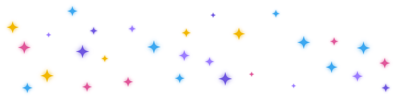

# Hola, soy Esther 👋

Profesora de **Medios Informáticos** en la Escuela de Arte de Zaragoza.
Enseño gráfica interactiva a estudiantes de diseño.

### En clase trabajamos
- 🧩 Diseño de interfaces (UI) y experiencia de usuario (UX)
- 📱 Prototipado interactivo en Figma
- 💻 Maquetación web con HTML, CSS y JavaScript
- 🌐 Creación de sitios con WordPress

### Me interesa explorar
Animación e interacción · Código creativo (p5.js) · Educación
